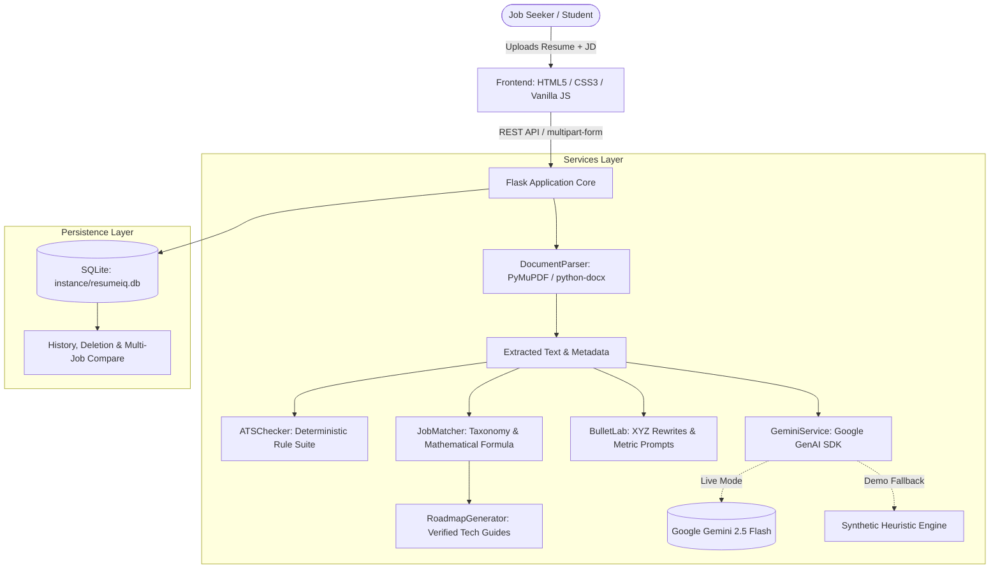
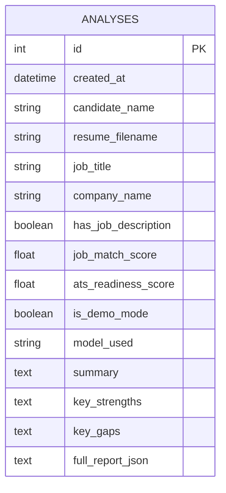

# ResumeIQ — AI Resume Analyzer & Career Copilot

[](https://www.python.org/)
[](https://flask.palletsprojects.com/)
[]()
[]()

> **Academic Project Demonstration**  
> An evidence-based, transparent web application that evaluates resume alignment against target job descriptions, identifies verified skill gaps, audits deterministic ATS formatting compliance, and generates actionable career roadmaps and honest bullet point improvements.

---

## Table of Contents

1. [Project Overview & Problem Statement](#1-project-overview--problem-statement)
2. [Limitations of Existing Systems](#2-limitations-of-existing-systems)
3. [Proposed Solution & Core Differentiators](#3-proposed-solution--core-differentiators)
4. [What is New in This Implementation?](#4-what-is-new-in-this-implementation)
5. [System Architecture](#5-system-architecture)
6. [Technology Stack & Rationale](#6-technology-stack--rationale)
7. [Mathematical Scoring Methodology](#7-mathematical-scoring-methodology)
8. [Features Breakdown](#8-features-breakdown)
9. [Installation & Local Setup](#9-installation--local-setup)
10. [Configuration & Environment Variables](#10-configuration--environment-variables)
11. [Running the Application](#11-running-the-application)
12. [Automated Testing & Verification](#12-automated-testing--verification)
13. [Database Design](#13-database-design)
14. [Security, Privacy & Ethical Considerations](#14-security-privacy--ethical-considerations)
15. [Reproducible Comparison Test Plan](#15-reproducible-comparison-test-plan)
16. [Future Scope](#16-future-scope)

---

## 1. Project Overview & Problem Statement

Students, fresh graduates, and transitioning professionals frequently struggle to navigate competitive automated hiring processes. While thousands of candidates apply for software engineering and technical roles, they face significant uncertainty regarding:
- Whether their resume effectively conveys qualifications relevant to a specific role.
- Which specific technical competencies mentioned in the job description are missing or unverified in their application document.
- How to structure bullet points to demonstrate concrete engineering ownership rather than passive duty summaries.
- How to acquire missing competencies through realistic, structured study instead of superficial keyword stuffing.

Most commercial resume tools present opaque, single-number "ATS Scores" without explaining how they were calculated, often encouraging candidates to copy and paste keywords into invisible text or fabricate accomplishments. **ResumeIQ** was created to replace black-box scoring with **evidence-grounded, transparent career diagnostics**.

---

## 2. Limitations of Existing Systems

Current resume evaluation tools exhibit several documented shortcomings:

1. **Opaque Scoring Algorithms:** Commercial platforms provide a single score (e.g., "78/100") without revealing the mathematical formula, weights, or reasoning behind deductions.
2. **Fabrication of Candidate Facts:** Generative AI tools frequently invent fake metrics (e.g., *"increased revenue by 45%"* or *"managed team of 12 engineers"*) that the candidate never achieved, exposing them to disqualification or fraud during background checks.
3. **Equating Unmentioned Skills to Inability:** Standard keyword matchers assume that if a skill is not written on the resume, the applicant cannot perform it. They fail to distinguish missing written evidence from an actual absence of competence.
4. **Non-Actionable Feedback:** Feedback is often vague (e.g., *"improve your action verbs"* or *"add more cloud skills"*) without providing curated projects, verified documentation links, or beginner starting actions.
5. **Privacy Risks:** Many commercial platforms permanently ingest candidate resumes into proprietary training corpuses without providing verifiable deletion workflows.

---

## 3. Proposed Solution & Core Differentiators

ResumeIQ addresses these limitations through a hybrid architecture combining **deterministic rule-based analysis** and **Google Gemini AI semantic reasoning**:

```
                                  ┌────────────────────────┐
                                  │   Uploaded Document    │
                                  │     (PDF / DOCX)       │
                                  └───────────┬────────────┘
                                              │
                         ┌────────────────────┴────────────────────┐
                         ▼                                         ▼
            ┌─────────────────────────┐               ┌─────────────────────────┐
            │   PyMuPDF / python-docx │               │  Job Description Text   │
            │  Text & Contact Parsing │               │     (Requirements)      │
            └────────────┬────────────┘               └────────────┬────────────┘
                         │                                         │
                         ├─────────────────────────────────────────┤
                         ▼                                         ▼
            ┌─────────────────────────┐               ┌─────────────────────────┐
            │   ATS Readiness Auditor │               │ Skill Gap & Match Engine│
            │  (Deterministic Rules)  │               │   (Transparent Formula) │
            └────────────┬────────────┘               └────────────┬────────────┘
                         │                                         │
                         ├─────────────────────────────────────────┤
                         ▼                                         ▼
            ┌─────────────────────────┐               ┌─────────────────────────┐
            │   Gemini 2.5 / Heuristic│               │ Career Roadmap & Lab    │
            │    Semantic Explanations│               │ (Anti-Fabrication XYZ)  │
            └────────────┬────────────┘               └────────────┬────────────┘
                         │                                         │
                         └────────────────────┬────────────────────┘
                                              ▼
                                 ┌────────────────────────┐
                                 │ Interactive Dashboard  │
                                 │   & SQLite Audit Log   │
                                 └────────────────────────┘
```

### Core Differentiators:
- **Evidence Quotes for Every Skill:** Every matched requirement cites the exact excerpt or sentence from the candidate's resume.
- **The Anti-Fabrication Rule:** The Resume Improvement Lab rewrites bullets using the Google XYZ formula but **never invents metrics**. If a figure is missing, it provides structured interactive prompts asking the user for their real numbers.
- **Transparent Mathematical Scoring:** Formula weights (50% Required Skills, 25% Preferred Skills, 15% Experience Alignment, 10% ATS Formatting) are fully disclosed.
- **Zero Permanent Document Retention:** Temporary files are immediately deleted from disk post-extraction.
- **Academic Demonstration Mode:** The app includes a complete offline heuristic engine so the entire platform functions reliably even if external API keys or network connections are unavailable.

---

## 4. What is New in This Implementation?

Unlike generic resume builders or basic OpenAI wrapper projects:

1. **Dual-Pillar Evaluation Separation:** ATS Formatting compliance is calculated deterministically through mechanical rules (character encoding health, heading detection, word volume), completely separate from AI semantic interpretation.
2. **Skill Family Bridging:** Recognizes transferable competencies (e.g., candidate has *Flask*, job asks for *Django*; candidate has *PostgreSQL*, job asks for *MySQL*) and categorizes them as **Partial Knowledge Bridges** (awarded 50% partial credit) rather than penalizing the applicant with a total failure.
3. **Side-by-Side Target Role Comparison:** Enables job seekers to evaluate the same resume against two distinct roles (e.g., *Full Stack Engineer* vs *DevOps Engineer*) to identify overlapping competencies, role-specific strengths, and shared gaps.
4. **Verified, Reputable Learning Roadmaps:** Every skill gap is linked to official, canonical documentation (e.g., Python.org, Docker Docs, React.dev, PostgreSQL docs) with estimated hours and a practical portfolio mini-project.

---

## 5. System Architecture

The project follows a modular, layered architectural pattern:



---

## 6. Technology Stack & Rationale

| Component | Technology | Rationale & Academic Justification |
| :--- | :--- | :--- |
| **Backend** | Python 3.11 - 3.14 + Flask 3.1 | Lightweight, performant microframework offering clear separation of REST endpoints without heavy framework overhead. |
| **Document Processing** | PyMuPDF (`pymupdf`) | Industry benchmark for high-speed, accurate C-level PDF parsing and font layout analysis. |
| **Document Processing** | `python-docx` | Native XML-level extraction of paragraphs and data tables from `.docx` files. |
| **AI Integration** | Google GenAI SDK (`google-genai`) | Official supported client SDK for Google Gemini 2.5 Flash, offering structured JSON schemas and sub-second semantic analysis. |
| **Validation** | Pydantic 2.14 | Strict runtime schema enforcement of all AI output payloads before rendering or persistence. |
| **Database** | SQLite + SQLAlchemy 2.1 | Zero-configuration, file-based relational database ideal for local academic inspection, testing, and easy teardown. |
| **Frontend** | Vanilla JavaScript (ES6+), Modern CSS3 | Fast, dependency-free client bundle with no complex build steps (no Node.js build pipelines required to run). |
| **Testing** | pytest 9.2 | Industry-standard test runner with automated fixtures, mocks, and parameterized assertions. |

---

## 7. Mathematical Scoring Methodology

ResumeIQ calculates the **Job Match Indicator** using a transparent, published linear scoring formula:

$$\text{Job Match Indicator} = (0.50 \times S_{\text{req}}) + (0.25 \times S_{\text{pref}}) + (0.15 \times S_{\text{exp}}) + (0.10 \times S_{\text{ats}})$$

Where:
- $S_{\text{req}}$ = Percentage score of required technical competencies matched:
  $$S_{\text{req}} = \frac{\sum \text{Matched} \times 1.0 + \sum \text{Partial} \times 0.5}{\text{Total Required Competencies in JD}} \times 100$$
- $S_{\text{pref}}$ = Percentage score of preferred / bonus technical competencies matched:
  $$S_{\text{pref}} = \frac{\sum \text{Matched} \times 1.0 + \sum \text{Partial} \times 0.5}{\text{Total Preferred Competencies in JD}} \times 100$$
- $S_{\text{exp}}$ = Seniority and experience alignment heuristic ($70\%$ baseline, up to $100\%$ when documented years match target requirements).
- $S_{\text{ats}}$ = Deterministic ATS Formatting Score (0–100) based on verified contact fields, standard headers, word volume, and text encoding.

> **Academic Notice:** This indicator measures document alignment against supplied text. It does not reproduce proprietary commercial ATS scoring and is not a probabilistic prediction of hiring.

---

## 8. Features Breakdown

### Feature A: Resume Intelligence
- **Candidate Metadata Detection:** Automatically extracts email, telephone, LinkedIn, and GitHub profiles via regular expressions.
- **Section Segmentation:** Identifies Education, Experience, Projects, Skills, and Certifications.
- **Grounded Analysis:** Generates documented strengths and growth areas grounded in the resume text.

### Feature B: Job Match & Skill Gap Engine
- **Taxonomy Matching:** Maps competencies across Languages, Frameworks, Cloud, Databases, and Architecture.
- **Evidence Quotes:** Highlights the exact sentence in the resume supporting each matched skill.
- **Transferable Family Bridges:** Identifies partial matches with contextual explanations.
- **Transparent Gap Notes:** Flags missing evidence without alleging candidate inability.

### Feature C: Personalized Career Roadmap
- **Prioritization:** Groups gaps into High Priority, Medium Priority, and Optional Enhancements.
- **Verified Resources:** Links directly to authentic official documentation (Docker, React, PostgreSQL, Python, AWS).
- **Practical Learning:** Provides a beginner first action, a portfolio mini-project, and an estimated effort range.

### Feature D: Resume Improvement Lab
- **Google XYZ Formula:** Transforms passive duty bullets into outcome-oriented impact statements.
- **Anti-Fabrication Guardrail:** Prompts the user for real numbers instead of generating fabricated metrics.
- **Interactive Editing:** Allows users to edit suggestions, accept, reject, copy to clipboard, or test custom bullet strings.

### Feature E: ATS Readiness Checks
- **Deterministic Rules:** Evaluates email presence, phone number, professional links, core section headers, word count range (350–1100 words), action verb frequency, and UTF-8 encoding health.
- **Actionable Remediation:** Explains the exact fix needed for any warning or failure.

### Feature F: Analysis History & Comparison
- **Audit Persistence:** Stores evaluation summaries and JSON reports in SQLite.
- **Multi-Job Comparison:** Select two analyses to compare how a single resume performs across two different roles.
- **Complete Data Purge:** One-click permanent wipe of all stored records.

---

## 9. Installation & Local Setup

### Prerequisites
- Python 3.10, 3.11, 3.12, 3.13, or 3.14
- Git

### Step-by-Step Installation

1. **Clone the repository:**
   ```bash
   git clone <repository_url>
   cd resumeiq
   ```

2. **Create and activate a virtual environment:**
   ```bash
   # On Windows
   python -m venv venv
   .\venv\Scripts\activate

   # On macOS / Linux
   python3 -m venv venv
   source venv/bin/activate
   ```

3. **Install dependencies:**
   ```bash
   pip install -r requirements.txt
   ```

---

## 10. Configuration & Environment Variables

Copy `.env.example` to `.env`:
```bash
cp .env.example .env
```

Edit `.env` to configure your settings:
```ini
# Flask Settings
FLASK_ENV=development
SECRET_KEY=your-random-secret-key
DEBUG=True

# Google Gemini API (Optional for demo mode, required for live LLM reasoning)
GEMINI_API_KEY=your_gemini_api_key_here
GEMINI_MODEL=gemini-2.5-flash

# Application Configuration
DEMO_MODE=False
UPLOAD_FOLDER=uploads_temp
MAX_CONTENT_LENGTH=5242880
DATABASE_URL=sqlite:///instance/resumeiq.db
```

> **Note on Demo Mode:** If `GEMINI_API_KEY` is not provided, ResumeIQ automatically runs in **Academic Demonstration Mode** using its built-in heuristic analysis engine. You can also configure or test an API key anytime via the UI Settings page.

---

## 11. Running the Application

Start the local development server:
```bash
python run.py
```

The application will start on:
```
http://127.0.0.1:5000
```

Open this URL in any modern web browser.

---

## 12. Automated Testing & Verification

The project includes an automated test suite with **23 unit and integration tests** covering document parsing, ATS checks, scoring formulas, bullet rewriting, Gemini mocking, database persistence, and API routes.

Run the test suite:
```bash
pytest
```

To run with verbose output and test names:
```bash
python -m pytest tests -v
```

### Verified Test Suite Summary:
- `test_document_parser.py`: Tests PDF and DOCX extraction, empty file rejection, corrupt file handling, and contact extraction.
- `test_ats_checker.py`: Validates deterministic scoring rules, contact presence, and word count penalties.
- `test_job_matcher.py`: Verifies skill taxonomy matching, partial family bridges, and mathematical formula calculation.
- `test_bullet_lab.py`: Ensures passive starter replacement, metric preservation, and anti-fabrication prompt generation.
- `test_gemini_service.py`: Validates Pydantic schema validation, mocked API responses, and synthetic demo fallback.
- `test_persistence.py`: Verifies SQLite CRUD operations, summary generation, and record deletion.
- `test_routes.py`: Verifies all HTML views, upload endpoints, export generation, and side-by-side job comparisons.

---

## 13. Database Design

ResumeIQ uses SQLite via SQLAlchemy with the following schema:



The `full_report_json` column stores the validated, complete report payload (matched skills, partial skills, missing skills, career roadmap, and interactive bullet rewrites) to guarantee fast listing and complete historical recall.

---

## 14. Security, Privacy & Ethical Considerations

- **Prompt Injection Defense:** Resumes and job descriptions are treated strictly as **untrusted data**, wrapped in isolated data delimiters, and never executed as system instructions.
- **File System Hygiene:** Uploaded files are assigned cryptographically random UUID prefixes (`uuid.uuid4()`), validated against size limits (5MB) and extensions, and **deleted immediately** after in-memory parsing.
- **Data Minimization:** Only text required for alignment diagnosis is processed. Personal identifiers are not retained outside local SQLite storage.
- **Ethical AI Stance:**
  - ResumeIQ does **not** claim to provide an official employer ATS score.
  - ResumeIQ does **not** guarantee interview invitations or employment offers.
  - Scores measure keyword and structural document alignment against supplied text only.

---

## 15. Reproducible Comparison Test Plan

To evaluate ResumeIQ against existing resume evaluators (e.g., Jobscan, Resume Worded, or generic ChatGPT prompts), follow this reproducible evaluation plan:

| Test Case | Test Input Document | Target Job Description | Evaluation Metric | Expected Behavior in ResumeIQ |
| :--- | :--- | :--- | :--- | :--- |
| **TC-1: Evidence Verification** | `sample_resumes/alex_chen_fullstack.pdf` | Senior Python & React Developer | Quote grounding | Matched skills (Python, React) show exact quotes from resume. |
| **TC-2: Unmentioned Competency** | `sample_resumes/alex_chen_fullstack.pdf` | Role requiring Kubernetes & Go | Evidence absence | Correctly labeled as "Missing Evidence" without claiming the candidate is unqualified. |
| **TC-3: Anti-Fabrication in Rewrites** | Bullet: *"Worked on database performance."* | Role requiring SQL optimization | Zero fake numbers | System rewrites using active verbs and provides a placeholder `[Add your real metric: e.g. X%]` without inventing a percentage. |
| **TC-4: Empty Document Rejection** | 0-byte file or scanned image PDF | Any Job Description | Error handling | Immediate user-friendly error explaining the file has no extractable text. |
| **TC-5: Dual-Role Comparison** | `sample_resumes/alex_chen_fullstack.pdf` | JD 1 (Full Stack) vs JD 2 (DevOps) | Score variation | Shows score delta, shared competencies, and unique gaps without claiming higher hiring chance. |

---

## 16. Future Scope

While the current version is feature-complete for local evaluation and academic presentation, planned extensions include:
- Optical Character Recognition (OCR) fallback for scanned image PDFs using Tesseract.
- Integration of LaTeX resume template generation (`.tex` export).
- Semantic embeddings via Vector Search for multilingual resume evaluations.
- Direct LinkedIn and GitHub portfolio live metadata synchronization.

---

## Academic Integrity & License

This project was engineered for academic research, demonstrations, and software engineering coursework. Licensed under the [MIT License](LICENSE).
